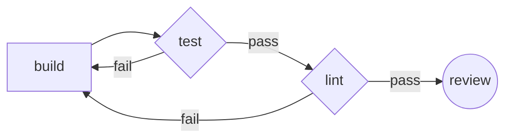
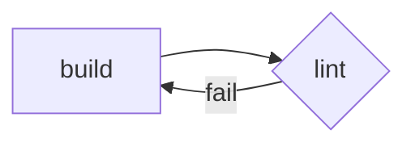
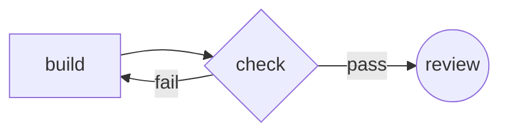
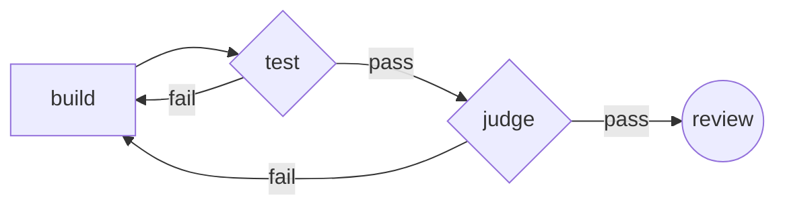
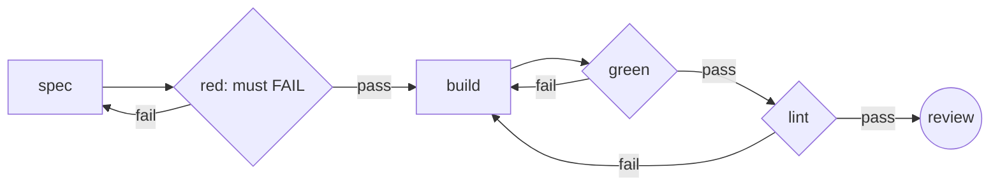
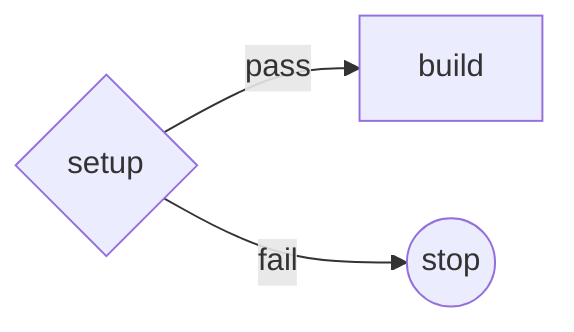
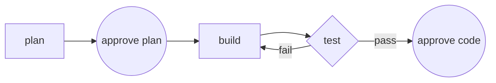
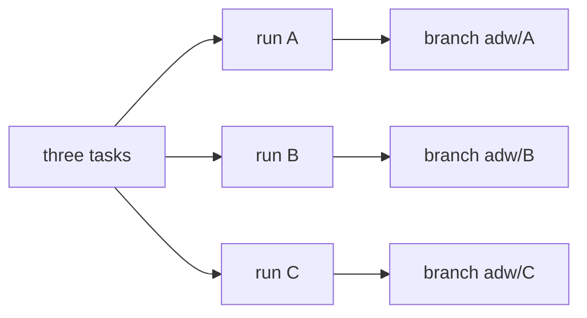

# adw.py

Agentic Developer Workflow - Python-level abstraction for controllable agentic
workflows. Suggestion friendly.

One sentence:

> Run a nondeterministic worker (a coding-agent CLI), then a deterministic gate
> (pytest / ruff / mypy), and let the gate's exit code decide what happens next.

The retry is the whole idea. It is **not** a re-roll of the same prompt - it is
the same prompt plus the reason the last attempt failed.

Single file, zero third-party dependencies, stdlib only.

---

## Quickstart

```bash
cd ADW
cp .env.example .env          # only needed for the local-endpoint worker
just demo                     # free, offline, no LLM - proves the loop works
just tutorial                 # the same run, narrated step by step
```

New here? `just tutorial` is a guided first run: it drives the free `demo`
workflow against a throwaway repo and explains what to watch for as it goes.
`just tutorial-interview` is the same, but you answer the human review gate.

Then, on a real repo with a clean tree:

```bash
./adw.py run "add rate limiting to /login" --repo ~/code/myapp
./adw.py show runs/<id>
```

Requirements: `python3` and `git` always; `claude` or `aider` for the worker;
`pytest` and `ruff` on PATH for the default gates. `validate()` checks all of
these up front and refuses before spending anything.

---

## The three step kinds

A workflow is a list of steps and a pointer. There are exactly three kinds.

| kind    | what it is                           | how it decides                      |
|---------|--------------------------------------|-------------------------------------|
| `agent` | a coding-agent CLI, in the workspace | always advances; nondeterministic   |
| `gate`  | any command                          | exit 0 advances, non-zero jumps to `on_fail` |
| `human` | you, looking at a diff               | approve / reject                    |

Gates are where reliability comes from: the agent cannot route around one and
cannot argue with an exit code.

## The built-in workflows

`WORKFLOWS` in `adw.py` *is* the diagram. `./adw.py graph <name>` prints the
mermaid below, so these can't silently drift from the code.

### `feature` - the default



### `chore` - mechanical changes, lint only



### `demo` - free, offline, deterministic



### `review` - an LLM judges the diff



### `tdd` - red/green, two agents



Boxes are agents, diamonds are gates, circles are human gates.

---

## Patterns

The step vocabulary is small on purpose, and more expressive than it looks.
Most of what people reach for "another step kind" to do is already a gate.

### An agent reviewing another agent is a gate

A gate is *any command that exits 0 or 1*. Point one at an LLM and you have a
second agent reviewing the first one's work - with no new machinery, because
adw.py already does the two things such a handoff needs:

- the **exit code** is the routing
- **stdout** becomes `feedback`, which is appended verbatim to the next prompt

`demo/judge.py` is a working one in ~90 lines of stdlib. Pair an expensive
writer with a cheap local reviewer:

```bash
ADW_JUDGE_MODEL=deep ./adw.py run "handle the zero case" --workflow review
```

The corollary: the judge is *not* privileged. It's a subprocess like pytest.
You can swap it for a shell one-liner and the flow doesn't notice.

### Agents hand off through the filesystem, not through messages

Two `agent` steps in a row is legal and is how multi-agent flows work here.
They communicate by editing the repo - see `tdd`, where `spec` writes a test
and `build` implements against it.

Resist adding a message channel between agents. The workspace is already a
better one: it's durable, inspectable, diffable, and committed per attempt.
If an agent needs to pass a *judgment* rather than an artifact, have it write
`PLAN.md`. Then that's in git too, and the human gate can see it.

### A passthrough gate is just a gate that always exits 0

Formatters, codegen, `npm install` - no special step kind:

```python
{"kind": "gate", "name": "format", "cmd": ["ruff", "format", "."],
 "on_fail": "build", "max": 1},
```

### Not every failure is the agent's fault

`on_fail: None` means *failure here is fatal, do not retry*. Use it for
anything environmental - a missing service, a broken endpoint, a setup step.
Retrying an agent against a broken environment burns money to reach the
identical failure.

```python
{"kind": "gate", "name": "setup", "cmd": ["docker", "compose", "up", "-d"],
 "on_fail": None},
```



### Gates are cheap, so use weird ones

The interesting ones aren't test runners:

```python
# scope guard - fail if the agent touched more than 8 files
{"kind": "gate", "name": "scope", "on_fail": "build", "max": 2,
 "cmd": ["bash", "-c", "test $(git diff --name-only {base} | wc -l) -le 8"]},

# no debugging left behind
{"kind": "gate", "name": "clean", "on_fail": "build", "max": 2,
 "cmd": ["bash", "-c", "! git diff {base} | grep -q '^+.*breakpoint()'"]},
```

`{base}` is substituted with the commit the run started from, so a gate can
inspect the whole run rather than the last attempt.

### Inverted gates prove a test tests something

`"invert": True` passes when the command *fails*. One good use: red/green.
Without it, an agent can satisfy a test gate with a test that asserts nothing.

### Spec-first, with two human gates

Nothing stops you gating twice - approve the plan before paying for the code:



### Parallelism is per run, not per step



Each `--worktree` run gets its own checkout and branch. There are deliberately
no parallel steps *inside* one flow - that's where a while-loop becomes a graph
engine, and this project has decided against being one.

---

## What a run leaves behind

`./adw.py show` is the interface - there is deliberately no dashboard. Every
run writes a directory you can read with `cat`:

```
runs/2026-07-24T16-08-19_make-the-failing-test-pass/
├── state.json          the whole run, rewritten at EVERY transition
├── events.jsonl        raw worker output + one adw.agent_start per attempt
├── stream-errors.log   worker lines that wouldn't parse (absent = healthy)
└── gates/
    ├── test.1.txt      full output of each gate invocation, per attempt
    └── lint.1.txt
```

`state.json` is plain JSON and hand-editable. Kill the process, edit the file,
`./adw.py resume` - that's the intended workflow, not a hack.

Useful keys:

| key             | meaning                                                  |
|-----------------|----------------------------------------------------------|
| `step`          | the pointer - which step runs next                       |
| `attempts`      | how many times each step has run, for the whole run      |
| `feedback`      | the gate output that will be appended to the next prompt |
| `gate_hashes`   | last failure per gate, for the loop detector             |
| `base` / `head` | commit before the run / most recent attempt commit       |
| `stream_types`  | tally of worker event types - see Troubleshooting        |

### Reading a timeline

```
timeline
  16:08:20       build -> check      be4be35   $0.000  build ok
  16:08:20       check -> build      be4be35   $0.000  check failed
  16:08:20       build -> check      f49aaca   $0.000  build ok
  16:08:20       check -> build      f49aaca   $0.000  check failed
  16:08:20       build -> check      840e0d2   $0.000  build ok
```

Every attempt is its own commit, so run history *is* git history:

```bash
git -C <workspace> log --oneline <base>..HEAD
git -C <workspace> diff be4be35 f49aaca      # what changed between attempts
```

Rerunning is not replay. The worker is nondeterministic, so
`resume --from build` gives you a *different* run to compare against the first,
not the same one back. That's what makes it useful for A/B-ing a prompt change.

---

## Safety rails

These exist because an unattended agent with a budget is a liability.

- **Flow validation** - step names, `on_fail` targets, `max` counts, binaries
  on PATH, required env vars, and that the repo is a git repo with a commit.
  Runs before a single token is spent.
- **Dirty tree refusal** - commit or stash first, or pass `--force`.
- **Per-attempt cost cap** (`--max-attempt-cost`, default $1) - the global
  ceiling is only checked *between* steps, so without this one attempt can
  sail straight past it.
- **Global cost + wall-clock ceilings** (`--max-cost`, `--max-wall`).
- **Loop detection** - two identical gate failures in a row means the agent is
  oscillating, not converging. Stopping there is pure savings.
- **Gate attempt caps** - `max` per gate.
- **Agent timeout** - a silent worker is killed, not waited on forever.
- **Secret scrubbing** - API-key-shaped strings are redacted before anything
  is written to disk.
- **Human gate refuses to guess** - with no tty it rejects and tells you how to
  resume, rather than hanging on `input()` or rubber-stamping a pipe. Pass
  `--auto-approve` if you actually want it unattended.

## Workers

A worker is a CLI that edits files in a directory. That is the entire contract,
which is why `WORKERS` is a dict and not a plugin system. Adding one means
adding a dict entry.

| worker   | notes                                                       |
|----------|-------------------------------------------------------------|
| `claude` | default. Tool-restricted and isolated from your user config. |
| `aider`  | any OpenAI-compatible endpoint; reads `.env`. No cost parsing - its output isn't structured, so `cost_usd` stays 0. |
| `codex`  | untested.                                                    |
| `demo`   | fake, free, deterministic. See `demo/`.                      |

`demo/judge.py` is not a worker - it's a *gate* that happens to call an LLM.
Set `ADW_JUDGE_MODEL` to review with a different (cheaper) model than
`ADW_MODEL` writes with.

Optional keys on a worker entry: `artifacts` (scratch paths to keep out of
attempt commits), `requires_env` (vars `validate()` insists on).

### Local endpoint

`.env` is gitignored - your endpoint address and key never belong in `adw.py`,
which is the part you might share.

```bash
cp .env.example .env
# OPENAI_API_KEY=...
# ADW_API_BASE=http://<host>:4000/v1
# ADW_MODEL=openai/fast
just local "fix the failing test"
```

## Parallel runs

Parallelism is per-*run*, via git worktrees - never parallel steps inside one
flow.

```bash
just parallel "task one" &
just parallel "task two" &
```

Each gets its own checkout and `adw/<run-id>` branch. The checkout is removed
after a clean run (`--keep-worktree` to keep it); a *failed* run always keeps
its checkout, because that's when you want to poke at it. The branch survives
either way - the commits are the deliverable.

---

## Troubleshooting

**`show` reports events but no tool calls, or the timeline is empty.**
Check `stream_types` in `show` output. If the worker emitted 40 events and none
are `assistant`, the parser and your CLI version disagree about the stream
shape. `stream-errors.log` has the lines that wouldn't parse, with the reason.

**Two flags that sound like one.** `--tools` decides which tools *exist*;
`--allowedTools` only pre-approves ones that already do. Passing
`--allowedTools` alone sandboxes nothing - the worker keeps full Bash and just
stops asking permission. The `claude` entry passes both.

**Worker cost varies run to run.** The worker inherits your environment. The
`claude` entry passes `--strict-mcp-config` and `--setting-sources project` so
your personal MCP servers and user-level hooks stay out; the workspace's own
project settings still apply, since those are part of the repo under work.
Dropping that noise cut observed cost per attempt by roughly half.

**The review diff is full of junk.** The worker littered in the repo. Add the
paths to that worker's `artifacts` list.

## Development

```bash
just check    # adw.py against the gates it enforces
just test     # check + both demo flows. Costs nothing.
```

`demo/` holds a fake worker and fake gates. Every retry path, breaker and
counter was verified through them, without paying an LLM and without
nondeterminism getting in the way.

Two tiers of tests back this up:

```bash
just test-py  # fast, hermetic pytest suite (does the code behave?)
just e2e      # real adw.py runs against throwaway sandboxes (does the tool work end to end?)
```

`e2e/` is also the best set of worked examples: each scenario builds a fresh
sandbox project (Rust, a PTY TUI, a seeded sim, a crashing run) and drives a
real `adw.py` run against it. `e2e/README.md` indexes them.

See `HANDOVER.md` for design constraints and what is deliberately out of scope.
